# TaskTrace 快速指南

适用于 Windows x64 免安装版，按 v1.0.2 的功能与界面编写。界面配图均使用独立演示数据，目录和网络地址仅作示例，请按自己的环境填写；点击配图可查看大图。

TaskTrace 用于整理项目、拆分任务、记录每日进展和遗留事项。置顶悬浮窗方便随手记录，完整网页界面用于浏览、编辑、协作和备份；两者共用本机数据，无需注册登录。

**第一次使用：下载 → 启动 → 创建项目 → 添加任务 → 保存进展 → 设置备份。**

## 目录

- [1. 下载与启动](#1-下载与启动)
- [2. 建立第一个项目](#2-建立第一个项目)
- [3. 记录每日进展与遗留事项](#3-记录每日进展与遗留事项)
- [4. 使用悬浮窗](#4-使用悬浮窗)
- [5. 团队协作](#5-团队协作)
- [6. 提醒、回顾与导出](#6-提醒回顾与导出)
- [7. 备份、恢复与升级](#7-备份恢复与升级)
- [8. 常见问题](#8-常见问题)

## 1. 下载与启动

### 直接使用免安装包

1. 打开 [GitHub Releases](https://github.com/niyilu45/TaskTrace/releases/latest)，下载 `TaskTrace-local-windows-x64.zip`。`Source code` 是源码，需要自行构建。
2. 将压缩包完整解压到可写目录，例如 `D:\Apps\TaskTrace`，不要直接在压缩包内运行。
3. 双击 `TaskTrace.exe`。成品运行不需要安装 Node.js、pnpm、Go 或数据库。
4. 启动后显示悬浮窗。点击悬浮窗或右击系统托盘图标中的“完整界面”，在浏览器中打开网页界面。

悬浮窗关闭或最小化后会隐藏到系统托盘；双击托盘图标可重新显示。真正退出请右击托盘图标，选择“退出 TaskTrace”。开机启动默认关闭，可在托盘菜单中启用。

[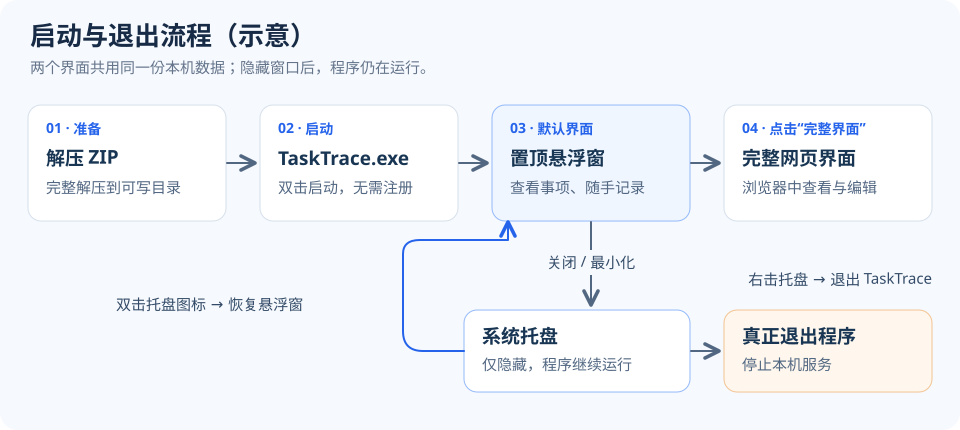](docs/images/quickstart/01-startup-flow.svg)

*图 1（示意）：运行 TaskTrace.exe 后先显示悬浮窗；关闭窗口只是隐藏到托盘，右击托盘并选择“退出 TaskTrace”才会停止程序。*

### 从源码安装

下载并解压 [仓库源码](https://github.com/niyilu45/TaskTrace/archive/refs/heads/main.zip)，双击 `dist/Install-TaskTrace.cmd`，在窗口中粘贴或选择安装目录。安装器会检查正在运行的程序及构建依赖，再生成程序；遇到缺失依赖时按提示补齐。

选择已有程序目录时，只更新程序文件并保留配置和数据。若提示强制关闭正在运行的 TaskTrace，先保存编辑内容，再决定是否继续。安装成功后可选择立即打开软件。

构建依赖、代理和故障日志详见 [源码安装说明](dist/README.md)。这些开发工具仅用于生成程序，运行成品无需安装。

## 2. 建立第一个项目

先区分三类内容：

| 内容 | 用途 | 示例 |
| --- | --- | --- |
| 项目 | 一张总表，容纳多个任务 | 产品验证 |
| 任务 / 子任务 | 可以独立记录描述、进展和完成状态的工作；任务层级最多 5 级 | 测试准备 → 准备测试环境 |
| 遗留事项 | 隶属某个任务、跨日期共享的待解决清单，可包含备注和图片 | 等待补充测试账号 |

1. 打开完整界面，从项目列表中的创建项目入口新建项目，输入项目名并保存。
2. 进入项目，默认看到紧凑的展示模式。点击右上角“进入编辑模式”，新增第一个任务。
3. 打开任务详情，填写描述；需要拆分工作时，在子任务区域添加子任务。
4. 编辑完成后点击“返回展示模式”。表格按层级展示任务名、描述、遗留事项和每日进展，较新的进展排在前面。

[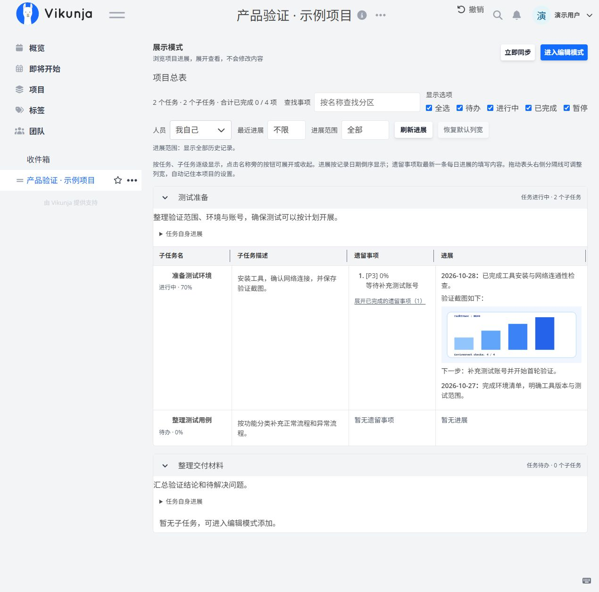](docs/images/quickstart/02-project-overview.jpg)

*图 2：项目页右上方的“进入编辑模式”用于切换编辑；总表按层级展示子任务、遗留事项和每日进展。*

任务有“待办、进行中、暂停、已完成”四种状态。“显示选项”支持多选状态；可按人员、近期有进展的天数等条件筛选。人员筛选默认只选自己，查看团队内容时请按需勾选其他成员。拖动表头分隔线可以调整列宽。

需要调整归属时，在左侧“概览”首页按住任务名，拖到目标任务下，或拖到项目的虚线框。移动任务会携带其子任务和遗留事项；拖动期间可用滚轮滚动页面。悬浮窗中调整任务归属会提示转到网页概览操作。

## 3. 记录每日进展与遗留事项

### 每日进展

1. 网页打开任务详情，在“记录每日进展”选择记录日期，默认今天。
2. 在“我的进展”中输入内容。支持直接粘贴文字、截图或混合图文，图片嵌入正文，可选中后用退格或 Delete 删除。
3. 点击“保存进展”，看到成功提示后才完成正式提交。悬浮窗的对应窗口也支持 `Ctrl+Enter` 保存。

[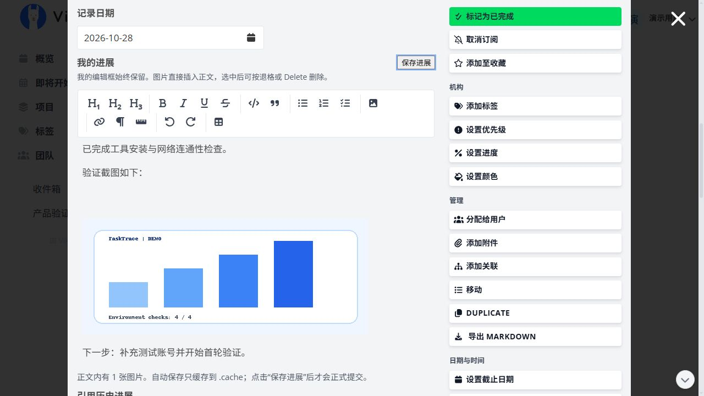](docs/images/quickstart/03-daily-progress.jpg)

*图 3：先选“记录日期”，再填写“我的进展”，最后点击旁边的“保存进展”；正文下方会说明图片数量及草稿缓存规则。*

**自动保存只把每日进展和遗留事项的未提交编辑缓存为 `.cache` 草稿，不等于正式保存，也不会把草稿同步给协作成员。** 请以保存成功提示为准。悬浮窗关闭有修改的编辑窗时，可选择保存、不保存或取消；选择不保存会丢弃该草稿。

切换到已有进展的日期可修改历史内容，日期下的蓝点表示当天有记录。协作任务会同时列出当天有进展的其他成员，具备写权限时可编辑其内容；评论区保留修改人及操作记录。

发现旧进展有误时，在新日期点击“引用历史进展”，勾选旧记录并确认，再写更正说明。引用保留当时内容，原记录不被替换。

### 遗留事项

1. 在任务详情点击“新增遗留事项”，输入内容，在标题右侧选择优先级，点击同一行的“添加遗留事项”。
2. 需要补充说明时，点击“添加遗留事项备注”展开备注编辑框；备注支持图文。已存在的遗留事项点击“编辑”后再修改、保存。
3. 完成后勾选其复选框。网页编辑界面会在 5 秒后将其移入已完成列表，点击“显示已完成的遗留事项”可再次查看。

[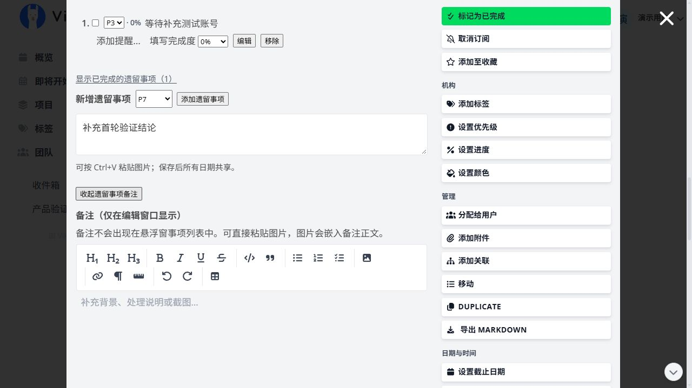](docs/images/quickstart/04-outstanding.jpg)

*图 4：优先级与“添加遗留事项”在标题同一行；备注按需展开，支持图文，已有遗留事项在上方逐条列出。*

遗留事项属于任务，与选择的进展日期无关；修改清单会影响所有日期下看到的当前清单。备注在遗留事项编辑窗中查看，悬浮窗任务列表不展示备注正文。

## 4. 使用悬浮窗

| 操作 | 方法 |
| --- | --- |
| 新增项目内的顶层任务 | 选择项目，点击底部“新事项” |
| 新增子任务 | 选中父任务，点击“新任务” |
| 新增遗留事项 | 选中任务，点击“新遗留” |
| 记录每日进展 | 选中任务，点击“记录进展”或双击任务；选中遗留事项后点“记录进展”会打开其所属任务的进展 |
| 编辑遗留事项 | 双击遗留事项，可编辑内容、备注、图片和提醒 |
| 调整优先级 / 背景色 / 状态 / 完成度 | 右击条目，使用对应菜单；也可点击条目前的优先级文字 |
| 批量操作 | `Ctrl+单击` 多选、`Shift+单击` 连选、`Ctrl+A` 全选当前筛选后可见条目，再右击操作或全部展开 / 收起 |
| 手动刷新 / 撤销 | `F5` 刷新；条目列表中 `Ctrl+Z` 撤销操作，编辑框中用于撤销输入 |

[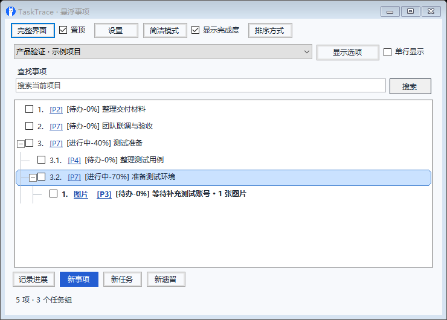](docs/images/quickstart/11-floating-full.png)

*图 5：完整悬浮窗。先选择项目，再选中任务；底部“记录进展”“新事项”“新任务”“新遗留”分别用于记录和新增。上方“完整界面”打开浏览器。*

优先级为 0～9，数字越小越优先，默认 7，可在设置中调整默认值。任务和遗留事项的优先级及悬浮窗背景色只影响本机，协作成员各自设置。

完成度默认 0%，以 10% 为步进。勾选“显示完成度”后会与状态合并显示，例如“待办-70%”。勾选完成复选框时显示 100%，取消勾选会恢复原先填写的完成度。“排序方式”可以组合优先级和完成度的升序、降序。

“简洁模式”隐藏大部分按钮，选中窗口后点击“完整”可返回完整悬浮窗。两种模式共用条目与筛选逻辑；“完整”与打开浏览器的“完整界面”是不同入口。

[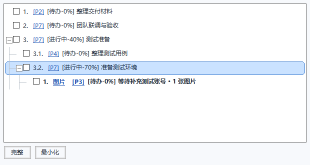](docs/images/quickstart/12-floating-simple.png)

*图 6：简洁悬浮窗。选中窗口后，下方显示“完整”和“最小化”；点击“完整”恢复完整悬浮窗，点击“最小化”隐藏到托盘。*

### 在悬浮窗中编辑

双击任务，或选中后点击“记录进展”，打开每日进展窗口。修改顶部任务名后点击“保存任务名”；任务描述通过“查看/编辑任务描述”展开，修改后单独保存。选择日期、填写图文后，再点击“保存当天进展”。日期旁的蓝点表示当天已有进展；“查看历史进展”用于浏览所有日期。

[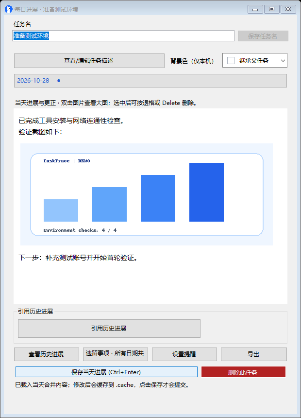](docs/images/quickstart/13-floating-progress.png)

*图 7：悬浮窗每日进展。图文直接在正文中编辑；底部可引用历史进展、查看历史、设置提醒、导出并保存当天进展。*

双击遗留事项可修改正文、优先级、背景色和图文备注。点击“保存修改”正式保存；“编辑所属任务”可打开其所属任务的每日进展窗口。备注不会显示在悬浮窗清单中。

[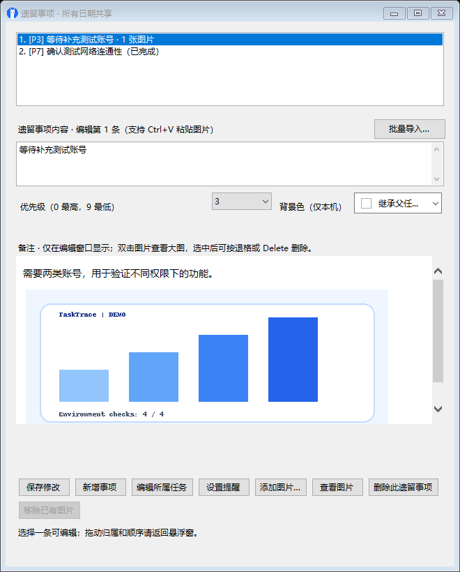](docs/images/quickstart/14-floating-outstanding.png)

*图 8：悬浮窗遗留事项编辑。上方选择清单条目，中间填写内容与备注，底部点击“保存修改”。备注图片可双击放大。*

右击托盘图标可重置悬浮窗位置、启用“边缘隐藏”、检查更新或立即同步。“便捷闹钟”提供 5 个预设闹钟及任意时长闹钟，多个闹钟可同时倒计时；取消勾选会停止并复位。

### 快捷备忘

右击系统托盘中的 TaskTrace 图标，选择“快捷备忘”，可随手记录文字和图片。图文编辑方式与遗留事项备注一致：支持粘贴、复制、撤销，以及双击图片放大。

内容自动保存到当前本机数据目录，关闭窗口、重启程序或通过 install 更新后仍会保留，并纳入现有数据备份。重复点击“快捷备忘”会唤回已打开的窗口。底部可查看保存状态和图片数量，也可点击“立即保存”；保存失败时窗口会保留内容并提示重试。

## 5. 团队协作

每个人运行自己的 TaskTrace，通过局域网中的 Windows 共享文件夹交换协作数据，无需把网页服务开放给其他电脑。

### 创建并分享协作任务（发起方）

先在项目中创建任务，再为它选择协作成员。已经存在的任务也可以直接打开并启用协作。

1. 打开项目，点击“进入编辑模式”，在“添加任务…”中输入名称，例如“团队联调与验收”，再点击“添加”。点击新建的任务名，打开任务详情。

[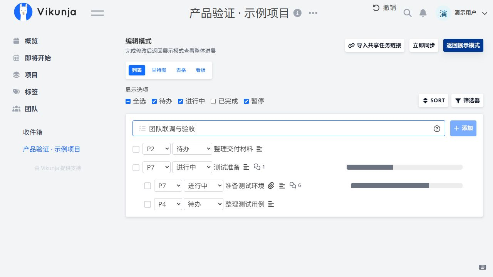](docs/images/quickstart/17-create-collaborative-task.jpg)

*图 9：先创建任务，再打开任务卡片设置协作。已有任务可以直接使用，无需重复新建。*

2. 进入左侧“团队 → 局域网协作 → 所有协作人员”，点击“添加协作成员”，按姓名、工号或邮箱关键字搜索并选择成员，等待成功提示。若 teamData 尚未共享，按提示确认创建共享；需要管理员权限时，再确认临时授权。

[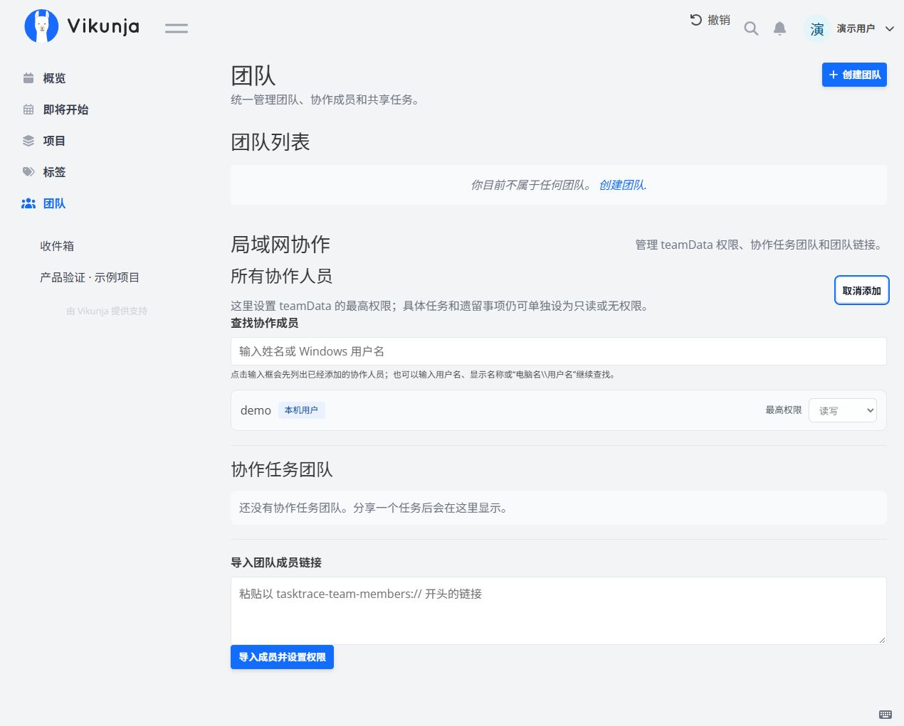](docs/images/quickstart/15-team-members.jpg)

*图 10：点击“添加协作成员”后出现搜索框；这里设置共享文件夹的最高权限，具体任务仍可单独限制权限。示例只列出本机演示用户。*

3. 回到任务详情，展开默认收起的“团队协作”，勾选或查找需要参与的成员，点击“共享当前任务”。只有自己不构成多人协作。

[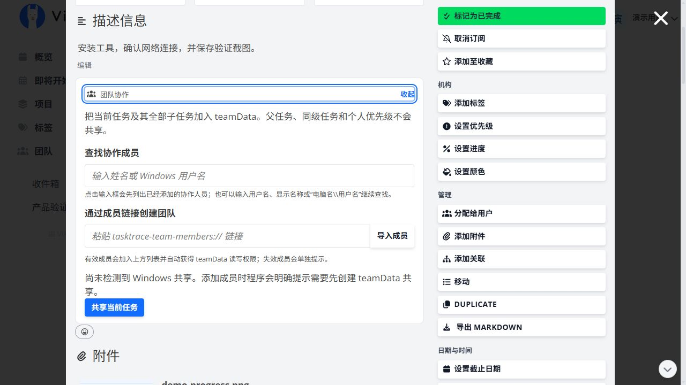](docs/images/quickstart/05-team-sharing.jpg)

*图 11：展开“团队协作”后查找或选择成员，再点击“共享当前任务”。此图展示共享前的界面。*

4. 共享成功后，在该区域的“任务链接”旁点击“复制链接”，将链接提供给接收者。接收者需要按下一节导入，才能把任务添加到自己的项目中。
5. 需要指定谁负责完成工作时，在任务中“分配给用户”选择受理人；在“团队协作 → 编辑权限”中核对每位成员的读写权限。需要对方修改内容时，团队页最高权限和该任务的写权限都应允许。

分享范围包含当前任务及其子任务、遗留事项和进展；不会包含上级任务或未分享的同级任务。

### 添加别人共享的协作任务（接收方）

1. 先确认能在文件资源管理器中访问分享者提供的 teamData 网络共享路径。
2. 打开网页左侧“概览”，点击“导入共享任务”，粘贴以 `tasktrace-team://` 开头的完整任务链接。
3. 在“保存到项目”中选择一个已有项目。电脑名无法访问时，可在“共享目录地址”填写实际网络路径，例如 `\\DEMO-PC\teamData`。如果原路径带有 `imports` 等子目录，必须完整保留。

[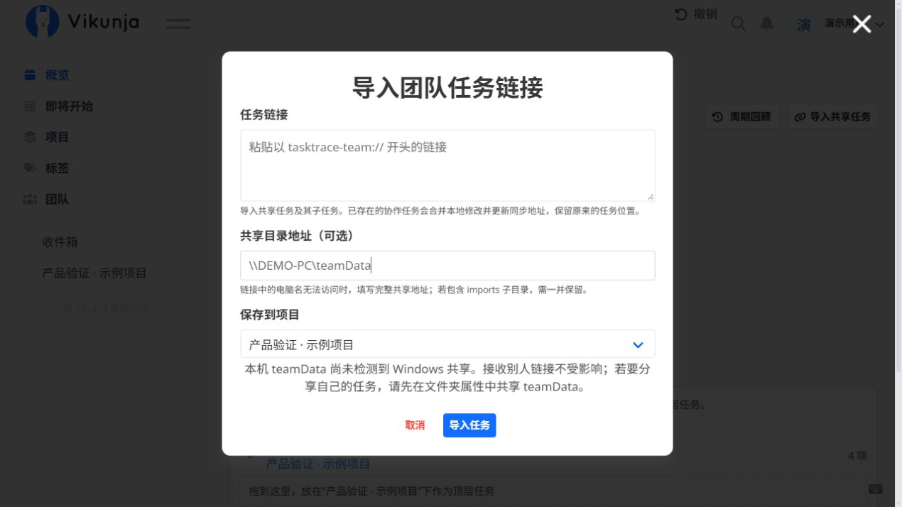](docs/images/quickstart/06-import-shared-task.jpg)

*图 12：把协作任务添加到已有项目：粘贴链接、核对共享地址，再选择保存项目。示例地址需替换为分享者提供的实际地址。*

4. 如果希望放入新项目，在下拉框选择“＋ 新建项目…”，填写“新项目名称”；点击“导入任务”后会先创建项目，再将协作任务添加进去。

[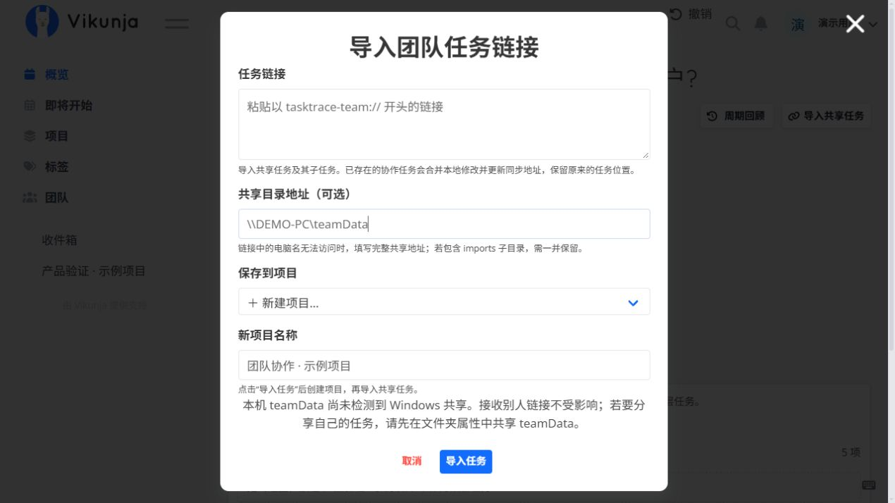](docs/images/quickstart/16-import-new-project.jpg)

*图 13：把协作任务添加到新项目：选择“＋ 新建项目…”，填写名称，然后点击“导入任务”。图中尚未填写真实任务链接。*

5. 导入成功后，在所选项目中打开任务，展开“团队协作”，核对协作连接信息和实际同步目录，再点击“立即同步”。之后在本机即可查看或按权限编辑任务、子任务、遗留事项和每日进展。

接收者可将导入任务放入自己的任务结构，不会改变其他成员的本地归属。如果原来只分享了子任务，后来改为分享整个父任务，需要接收者导入新的父任务链接，旧链接不会自动扩大范围。

### 在协作任务中继续添加内容

- **添加子任务**：网页打开协作任务，在“相关任务”中填写“新子任务名称”，点击“添加子任务”；悬浮窗选中该任务后点击“新任务”。
- **添加遗留事项**：网页任务详情点击“新增遗留事项”，填写后点击“添加遗留事项”；悬浮窗选中任务后点击“新遗留”，填写后保存。
- **添加每日进展**：选择日期，填写自己的进展并点击保存。自动缓存的草稿不会同步给别人。

新增子任务和遗留事项会继承协作成员及权限，并可按权限单独调整。正式保存后可以点击“立即同步”同步已保存的内容；遇到权限提示时，请由有权限的成员调整任务及共享文件夹权限后再操作。

### 权限、同步与通知

- “团队 → 所有协作人员”管理共享文件夹的最高权限；任务内“团队协作 → 编辑权限”可进一步限制具体成员的读写权限。所属人和受理人具有任务读写权限，其他成员按配置执行。
- 修改协作内容需要同时满足任务权限和共享文件夹权限；个人优先级独立保存，不受共享任务的只读限制，但仍需有本地项目编辑权限。
- 先正式保存内容，再同步。托盘右键菜单或网页项目页“进入编辑模式”左侧的“立即同步”可手动同步；任务的“团队协作”中可查看同步目录和最近错误。
- “更新后通知其他协作成员”控制更新通知。成员更新和冲突都在网页顶部铃铛中查看，点击更新通知可定位内容并标为已读；清除后可在历史通知中查看。
- 出现冲突时，从铃铛打开差异对比，逐项处理。网络断开时保留本地修改，恢复连接后再同步；不要手工编辑 `teamData` 中的同步文件。

## 6. 提醒、回顾与导出

- **事项提醒**：在任务 / 遗留事项的提醒入口，或悬浮窗右键“设置提醒”中设置。支持单次提醒、每周多选星期以及日期范围。到时弹窗可关闭本次提醒，或延迟后再提醒；周期提醒的后续日期不受关闭本次影响。
- **周期回顾**：网页“概览 → 周期回顾”，选择项目及过去天数或起止日期，默认全部项目、过去 7 天。在新标签页按展示模式浏览，按项目 / 任务导航，并导出 Markdown。仅列出周期内进展或遗留事项有变化的任务；遗留事项展示当前内容及新增、完成、改动标志，已删除的内容不展示。
- **任务导出**：网页任务详情卡片右侧“管理”中的“导出 Markdown”，或悬浮窗任务编辑窗中的导出入口。可先预览，再选择保存位置；导出已保存的内容和可读取的子任务，图片内嵌到 Markdown 文件中。部分外部 Markdown 查看器不支持内嵌图片，可用程序预览。导出成功后，网页通知中会显示保存位置并提供打开所在文件夹的链接。

[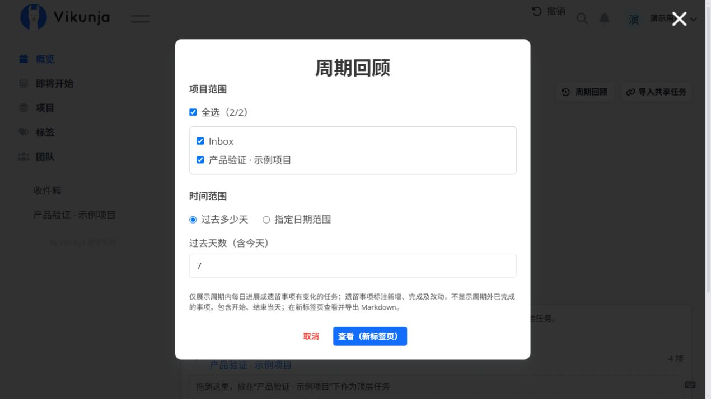](docs/images/quickstart/07-period-review.jpg)

*图 14：周期回顾默认勾选全部项目、过去 7 天；确认范围后点击“查看（新标签页）”，进入报告并导出 Markdown。*

## 7. 备份、恢复与升级

### 先配置备份

进入网页“设置 → 数据保护与恢复”，启用定时备份，填写备份路径、每天备份时间、保留天数和最少保留份数，再点击“保存备份设置”。程序需要在计划时间保持运行。可随时点击“立即备份”；数据没有变化时跳过，节约空间。

[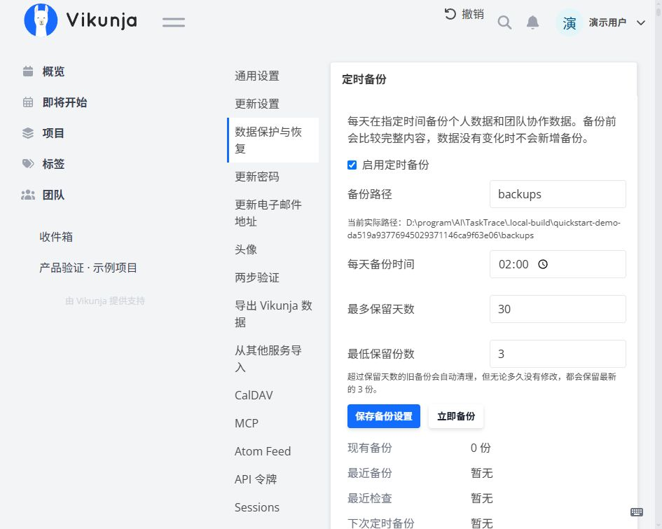](docs/images/quickstart/08-backup-settings.jpg)

*图 15：设置每天执行的时间及保留规则，点击“保存备份设置”；需要现在备份时使用“立即备份”。图中的路径属于隔离演示环境。*

备份覆盖配置的个人数据与团队数据。超过保留天数后自动清理旧备份，但仍保留最低份数。建议将备份放在程序目录以外的位置。

### 恢复已有数据

- **从备份恢复**：点击“查看可恢复备份”，核对日期、备注和路径，选择“恢复此备份”。可给备份写备注；手动删除备份为永久删除，不受最低保留份数保护。
- **从复制的目录导入**：在“检测数据”中填写 `data` 路径；配套 `teamData` 若不在旁边，单独填写团队数据路径，再检测并确认导入。单独的 `teamData` 不含个人数据库，需要配套 `data`。

恢复和导入会复制到新的受保护目录，当前数据及源数据不会直接覆盖。按页面提示退出并重新启动 TaskTrace 后生效。

[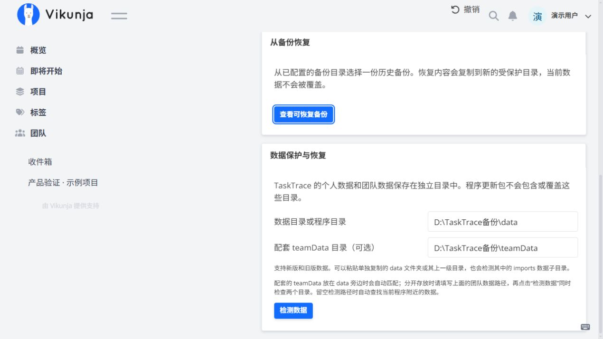](docs/images/quickstart/09-data-recovery.jpg)

*图 16：已有备份使用“查看可恢复备份”；从外部复制的数据使用“检测数据”，分别填写个人数据与配套团队数据路径。*

### 保存目录与安全升级

| 位置 | 内容 / 作用 |
| --- | --- |
| `data` | 个人任务、数据库、图片、身份信息及本地设置，包含本地的协作任务 |
| `teamData` | 用于交换协作任务的团队仓库 |
| `tasktrace-settings.json` | 本机数据路径和备份配置 |
| `.cache` | 尚未正式保存的编辑草稿 |
| `backups` | 默认备份目录，可在设置中更改 |

以上目录可因个人配置而变化。使用 `Configure-TaskTrace.cmd` 可修改数据目录；仅修改路径不会自动搬移数据，迁移请优先使用“数据保护与恢复”。

网页“设置 → 更新设置”或托盘“检查更新”可检查新版、查看版本差异并选择更新。默认启动时检查，此后每 60 分钟检查一次，可修改间隔；联网使用 Windows 系统代理。

[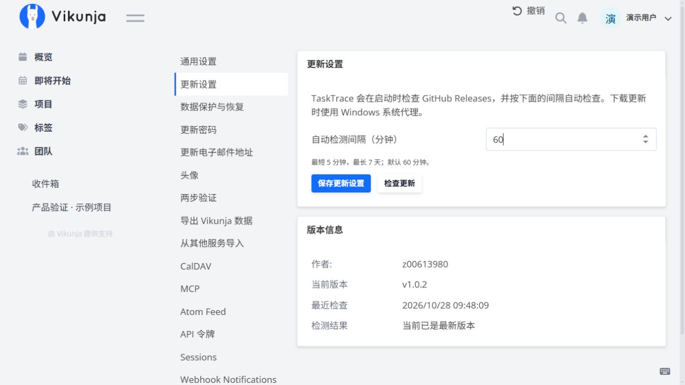](docs/images/quickstart/10-update-settings.jpg)

*图 17：在“更新设置”保存自动检测间隔，或点击“检查更新”主动检测；下方显示当前版本及检测结果。*

手动升级前保存内容并退出程序，再用 Release ZIP 或源码安装器生成的 `dist/TaskTrace-program-files.zip` 覆盖程序文件。**保留原有 `data`、`teamData`、配置、草稿和备份；不要将另一台电脑上运行过的整个程序目录直接覆盖过来。**

## 8. 常见问题

| 问题 | 先检查 |
| --- | --- |
| 启动提示已有程序运行 | 查看系统托盘，退出原实例后再启动，隐藏窗口不等于退出 |
| 悬浮窗比网页少条目 | 选择同一项目、清空查找条件、优先级设为全部，并在“显示选项”中全选；同时检查树是否收起，单行模式是否隐藏了非末级任务 |
| 看不到其他成员的内容 | 先检查人员筛选，再确认对方已正式保存；两边立即同步，核对同一共享范围、实际网络目录（含 imports）和最近错误 |
| 能看到共享文件夹但保存失败 | 同时检查文件夹共享 / 文件权限及任务写权限；在团队页和任务“编辑权限”中核对，管理员授权仅在弹出提示时使用 |
| 安装失败 | 按窗口提示补齐依赖，查看源码目录 `dist/install.log`；完整说明见 [源码安装说明](dist/README.md) |
| 检查更新失败 | 检查网络和系统代理，或从 [Releases](https://github.com/niyilu45/TaskTrace/releases) 手动下载 |

反馈问题时提供版本、操作步骤及错误详情，可通过 [GitHub Issues](https://github.com/niyilu45/TaskTrace/issues) 提交。请勿上传真实任务数据、团队链接或带登录凭据的配置与会话文件。
